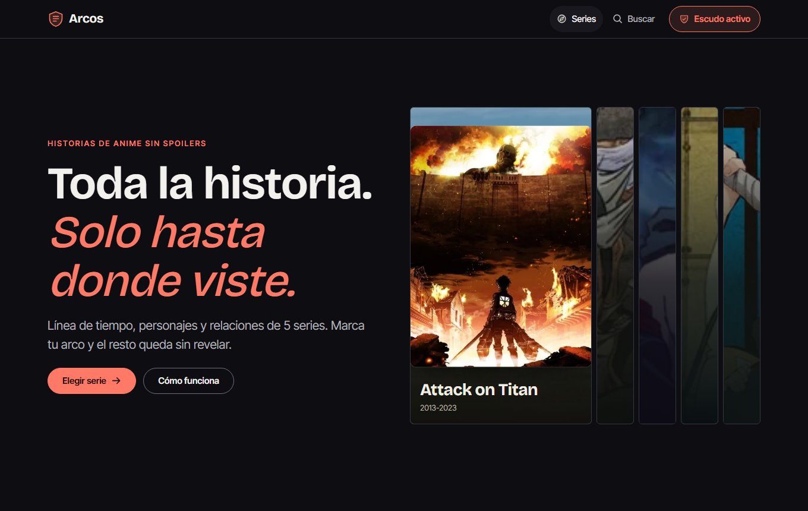
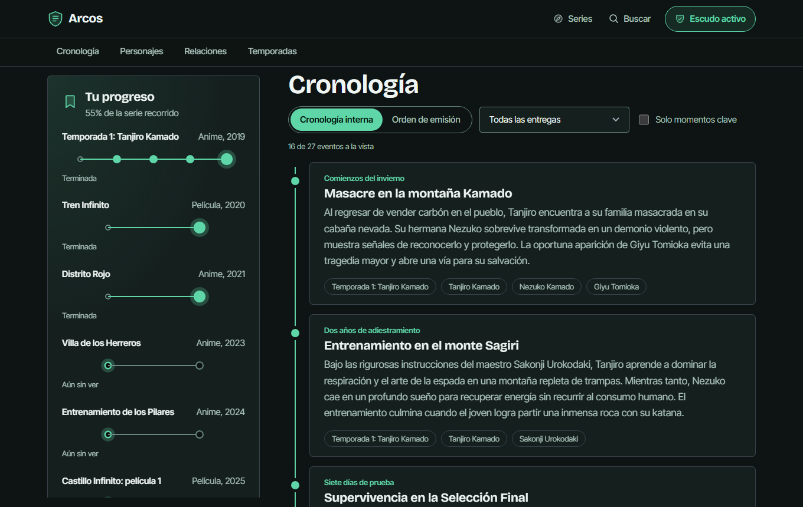
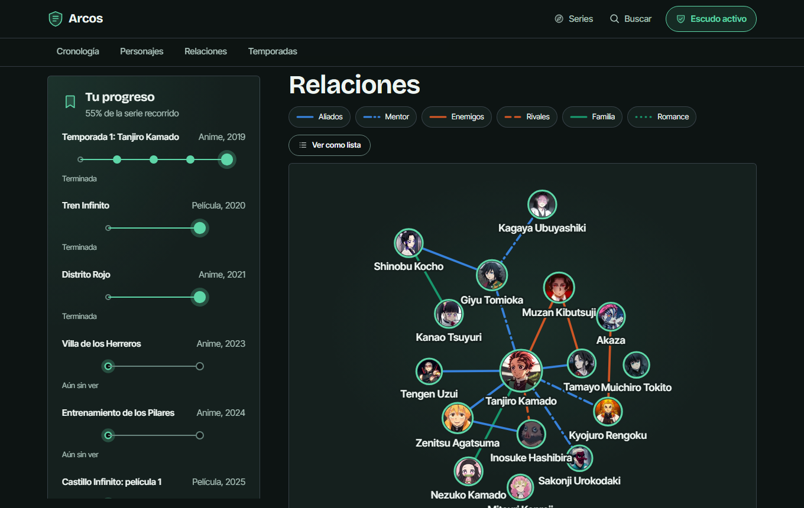
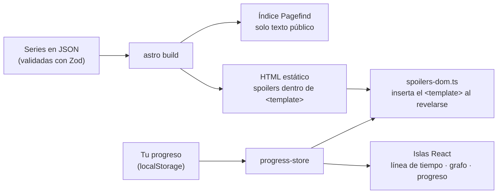

# Arcos

**Repasa la historia de tus animes favoritos sin spoilers de lo que aún no has visto.**

Línea de tiempo, personajes y mapa de relaciones de cinco series (Kimetsu no Yaiba, Attack on Titan, Jujutsu Kaisen, Black Clover y Kaiju N.º 8). Marcas el último arco que terminaste y todo lo que viene después queda **sin revelar**, incluido lo que por ahora solo está en el manga.

**Demo:** https://jdmahecha1.github.io/arcos/

[](https://github.com/jdmahecha1/arcos/actions/workflows/ci.yml)



## Qué hace

| | |
|---|---|
| **Tu progreso** | Por cada temporada, película o tramo de manga, un camino de puntos (uno por arco). Al marcar uno, lo anterior se da por visto. Por dentro son radios nativos: funciona con teclado y lector de pantalla. |
| **Anime y manga separados** | Lo que aún no se anima va en su propia entrada, así que si sigues solo el anime nunca te lo encuentras. Las películas opcionales no afectan al resto. |
| **Escudo de spoilers** | Cada evento, personaje, dato, relación y portada lleva la marca del arco en el que se descubre. Lo que aún no viste se agrupa en bloques que puedes abrir si quieres. |
| **Línea de tiempo doble** | Cronología interna (los flashbacks primero) u orden de emisión, con filtros por entrega y "solo momentos clave". |
| **Mapa de relaciones** | Grafo de fuerzas con vínculos, conflictos y afectos (colores validados para daltonismo, con el trazo como segunda pista) y una vista alternativa en lista. |
| **Identidad por serie** | Cada serie tiene su paleta (con contraste WCAG AA verificado en pruebas), su arte oficial y un paisaje generativo propio como respaldo. |
| **Búsqueda sin spoilers** | Índice estático con Pagefind que solo contiene texto público. |
| **Sin cuentas ni servidor** | El progreso vive en `localStorage`. El sitio es HTML estático en GitHub Pages: cuesta $0. |





## Cómo funciona el escudo



La regla es una sola función pura (`src/lib/spoilers.ts`):

```ts
// Un dato descubierto durante el arco N es visible cuando el espectador terminó ese arco.
export function isRevealed(marker: Marker | undefined, shield: Shield): boolean {
  if (!shield.enabled || !marker) return true;
  return (shield.progress[marker.season] ?? 0) > marker.arc;
}
```

Detalles que evitan spoilers por la puerta de atrás:

- **El texto protegido no se desenfoca, se omite.** Astro lo emite dentro de un `<template>` inerte y un script lo inserta solo cuando corresponde. Sin JavaScript, sigue oculto. (Sí está en el código fuente: el escudo protege de leer algo por accidente, no de quien lo busca a propósito).
- **Los nombres de los arcos también son spoilers.** Solo se muestran los terminados o en curso; el resto aparece como "arco 3 de 5". Lo mismo con las portadas: cada una se revela al terminar la entrega anterior.
- **Las relaciones esperan a los dos personajes.** Una relación marcada en el primer arco no aparece si uno de los personajes se revela en el tercero. La compilación falla si un texto nombra a alguien antes de que aparezca.
- **Los personajes cuya sola existencia es un spoiler** no ponen su nombre en el título de la pestaña ni en la búsqueda, y no aparecen en el sitemap.
- **El grafo no se mueve al avanzar.** Las posiciones se calculan con todas las relaciones y una semilla fija, así que el HTML del servidor y del cliente coinciden y revelar una conexión no reacomoda el mapa (ni delata cuántas faltan).

## Seguridad

Sin servidor, base de datos ni claves: la superficie de ataque es mínima y el hosting (GitHub Pages) absorbe el tráfico. Aun así, cada página lleva una CSP con hashes (sin `eval` ni scripts en línea ajenos), la búsqueda filtra el HTML que inserta, el progreso leído del navegador se valida, y la CI audita dependencias y prueba en el navegador que no haya violaciones de la CSP. Detalles en [SECURITY.md](SECURITY.md).

## Pila técnica

- **[Astro 7](https://astro.build)**: generación estática, una página por serie y por personaje.
- **React 19** en islas: panel de progreso, línea de tiempo, grafo, búsqueda e interruptor del escudo, sincronizados con `useSyncExternalStore` (también entre pestañas).
- **Diseño:** Bricolage Grotesque e Inter Tight (autoalojadas), iconos de Phosphor, escalas cerradas de 7 tamaños de letra y 8 espaciados, y movimiento que respeta `prefers-reduced-motion`.
- **Zod 4**: esquema del contenido + verificación de integridad (referencias rotas, arcos inexistentes, ids duplicados, spoilers fuera de orden). Si un JSON está mal, la compilación falla con el motivo.
- **d3-force**: disposición del grafo, calculada en el servidor.
- **Pagefind**: búsqueda estática.
- **Vitest + fast-check**: pruebas unitarias y de propiedades. **Playwright**: pruebas de punta a punta en escritorio y móvil.
- **GitHub Actions**: tipos, pruebas, compilación y e2e en cada push; publicación automática en GitHub Pages.

## Estructura

```
src/
  content/series/*.json     contenido: entregas, arcos, personajes, eventos, relaciones
  lib/schema.ts             esquema Zod y tipos
  lib/integrity.ts          referencias cruzadas que Zod no puede validar
  lib/spoilers.ts           reglas del escudo (funciones puras)
  lib/progress-store.ts     estado en localStorage + suscripción
  lib/graph-layout.ts       disposición determinista del grafo
  lib/themes.ts             paleta de cada serie (contraste probado en tests/themes.test.ts)
  lib/landscape.ts          paisajes generativos y deterministas
  components/               islas React y componentes Astro (SavePanel, Timeline, FogGroup…)
  scripts/spoilers-dom.ts   revela los <template> de las páginas estáticas
  pages/                    portada, serie, personaje, búsqueda, cómo funciona
tests/                      Vitest: motor, contenido, almacenamiento y grafo
e2e/                        Playwright: el escudo en el navegador real
```

## Ejecutarlo

Requiere Node 22 o superior.

```bash
npm install
npm run dev          # http://localhost:4321/arcos/
npm test             # pruebas unitarias y validación del contenido
npm run build        # sitio estático en dist/ con índice de búsqueda
npm run preview      # sirve dist/ (la búsqueda solo funciona aquí)
npm run test:e2e     # Playwright (npx playwright install chromium la primera vez)
npm run check        # tipos de Astro y TypeScript
```

No necesita variables de entorno ni claves.

## Agregar o corregir una serie

1. Crea `src/content/series/<id>.json` con la forma de `src/lib/schema.ts` (los JSON existentes sirven de ejemplo).
2. Marca cada dato con `{ "season": "<id-entrega>", "arc": <índice> }`: el arco **en el que el espectador lo descubre**. Ante la duda, usa uno posterior. Las entregas se escriben en orden de visionado, con el manga al final.
3. Omite `appears` en los personajes conocidos desde el primer episodio.
4. Ejecuta `npm test`: valida el esquema, las referencias y que ningún texto nombre a un personaje antes de que aparezca.

¿Ves un error de canon? [Abre un issue](https://github.com/jdmahecha1/arcos/issues).

## Sobre el contenido

Los resúmenes son propios. Se redactaron con ayuda de IA a partir de fuentes públicas y después se revisaron contra el canon. Las fechas de lo que sigue en emisión o aún no se estrena se actualizan a mano.

Las portadas y los fondos son arte oficial tomado de [AniList](https://anilist.co) mediante su API pública. Los retratos son imágenes del anime compartidas en Pinterest, elegidas a mano una por una; como ahí no siempre consta el autor original, se enlaza cada pin. `src/content/art-sources.json` dice qué corresponde a cada cosa, `npm run art` las baja y guarda su fuente, y `npm run images` las convierte a WebP. Todo se usa sin fines comerciales y con crédito: la página [Créditos](https://jdmahecha1.github.io/arcos/creditos/) enlaza cada imagen a su fuente y explica cómo pedir que se retire.

Arcos es un proyecto de fans sin ánimo de lucro y sin relación con los autores, estudios ni editoriales de las series. Los nombres de las series y personajes pertenecen a sus dueños.

## Licencia

Código bajo licencia [MIT](LICENSE). Textos de `src/content/` bajo [CC BY-SA 4.0](https://creativecommons.org/licenses/by-sa/4.0/deed.es).

---

Hecho por [toriikarii](https://github.com/jdmahecha1), estudiante universitario y aprendiz del SENA (ADSO).
